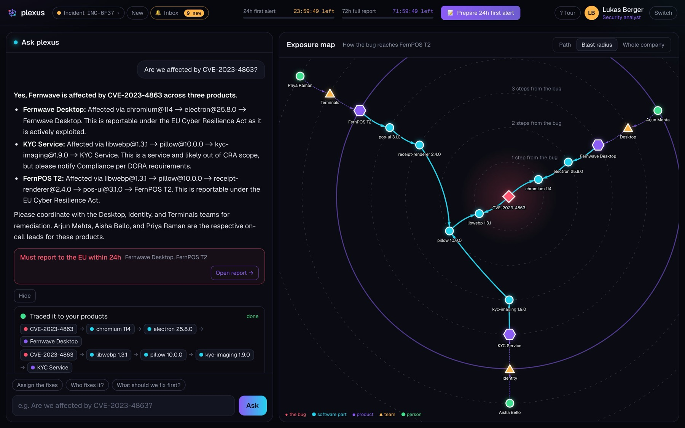
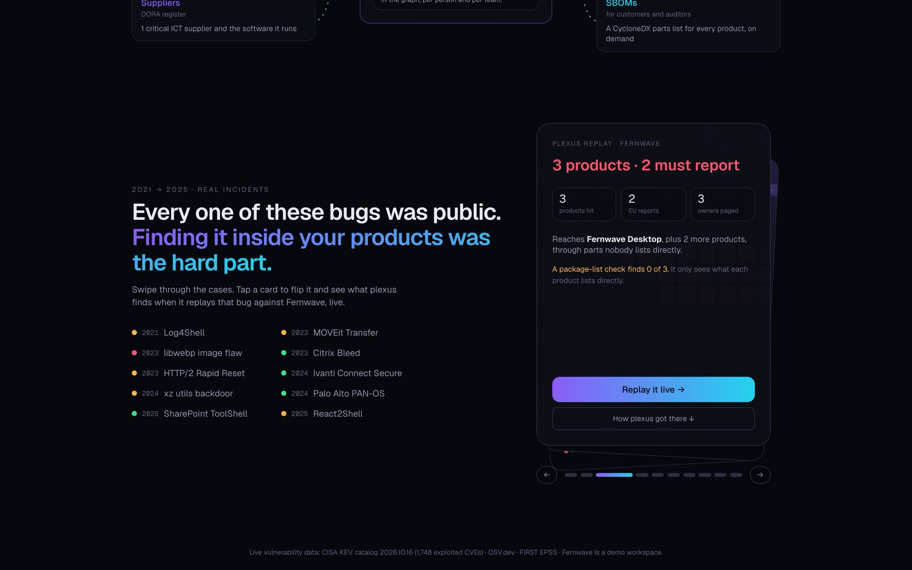
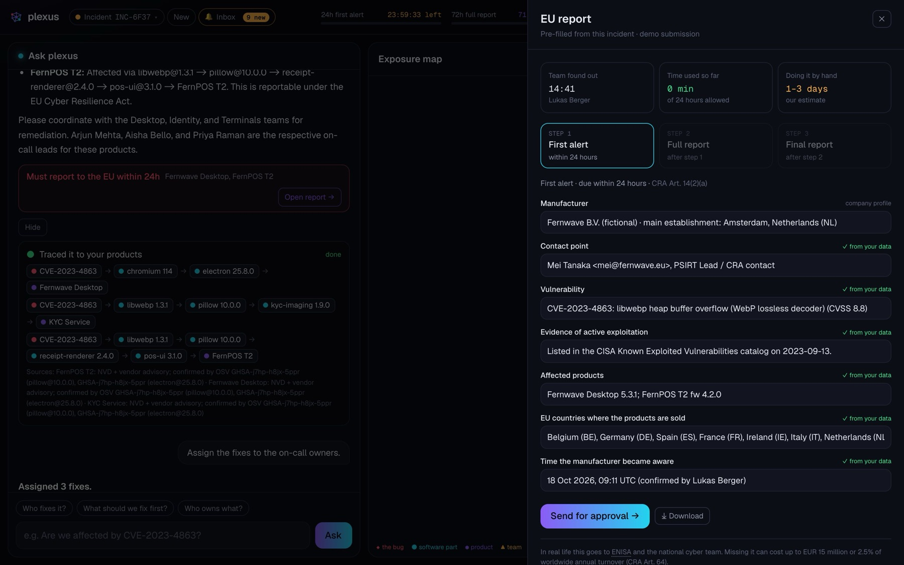
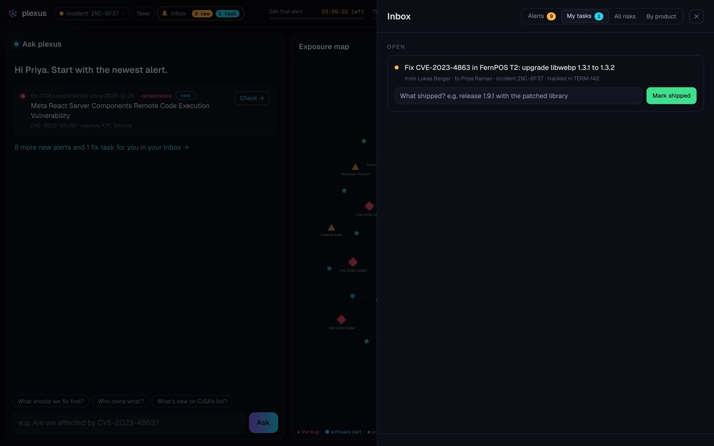
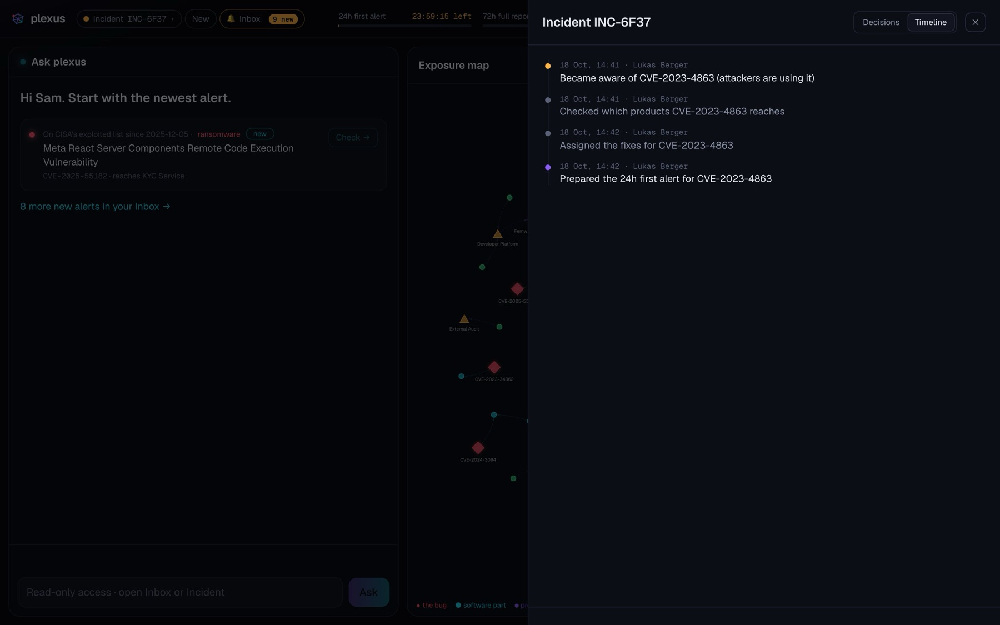

# plexus

**Every vulnerability, traced to every customer.**

When a new security bug is being exploited, plexus tells you which of your products it's hiding in, who needs to fix it, and whether EU law says you have to report it within 24 hours. Then it fills in that report for you.

It's built on a [FalkorDB](https://www.falkordb.com/) graph.

[Live](https://plexus-e0xc.onrender.com/) · [Video](#) · [Run it locally](#run-it)



---

## Why I built this

From September 2026, any company selling software or connected devices in the EU has 24 hours to warn the authorities once it knows a bug in its product is being exploited.

Writing that warning isn't the hard part. Knowing whether the bug is even in your product is, because it's usually buried three or four libraries deep. When libwebp broke in 2023, everyone called it a Chrome bug. It was also inside Electron apps and Python's Pillow, and teams that only checked for Chrome missed it.

That felt like a graph problem to me. A bug, the library it's in, everything that uses that library, the products built from those, the countries they're sold in, the team that owns them, the person on call: it's all one chain of connections. So I put all of it in one graph and built the tool a security team would actually use around it, where one person checks, another approves, engineers fix, and someone can audit it all later.

---

## Try it

The demo runs on **Fernwave**, a made-up EU fintech with 13 products and 24 people. The bugs are real.

1. **On the landing page, flip the libwebp card.** A normal package-list check finds 0 of the 3 Fernwave products that have this bug.
2. **Sign in as Lukas** (security analyst) and click **Check** on the libwebp alert. You get 3 products, the exact chain for each, and who owns it. Two must be reported to the EU, and the 24-hour clock starts.
3. Click **How we know** to see every step and the advisory behind each link.
4. Click **Assign the fixes.** Each fix goes to the right team's on-call engineer and is linked to the ticket already tracking it.
5. **Prepare the 24h alert.** It's already filled in. Lukas can't send it; he sends it for approval.
6. **Switch to Mei** (security lead) and approve it. It's sent, and the clock turns green.
7. **Switch to Priya** (engineer). The fix is in her inbox. Mark it shipped, and her task and ticket both close.
8. **Switch to Sam** (auditor) and open the incident's **Timeline.** Everything above is there, in order, with who did what.

You can also just ask things: *"Why is KYC Service out of CRA scope?"*, *"Are we affected by MOVEit?"*, *"Who knows Pillow?"*, *"What should we fix first?"*

Every person's flow, with what you should see at each step: [docs/PERSONA_FLOWS.md](docs/PERSONA_FLOWS.md)

<table>
<tr>
<td width="50%"><br><sub>Real incidents, replayed against Fernwave</sub></td>
<td width="50%"><br><sub>The 24-hour report, filled in from the graph</sub></td>
</tr>
<tr>
<td><br><sub>Priya's fix task, linked to her ticket</sub></td>
<td><br><sub>What happened, and who did it</sub></td>
</tr>
</table>

---

## How it works

Everything lives in one graph: vulnerabilities, every version of every library, the products that ship them, the countries they're sold in, teams, people, tickets, chat, documents, decisions and suppliers.

The main question, "which products does this bug reach?", is a single walk through it:

```cypher
MATCH path = (v:Vulnerability {id: 'CVE-2023-4863'})-[:AFFECTS]->(:Component)
             <-[:DEPENDS_ON*0..10]-(:Component)<-[:SHIPS]-(p:Product)
RETURN p.name, [n IN nodes(path) | coalesce(n.id, n.key, n.name)] AS how_it_gets_in
```

Everything else is a few more steps from there: who owns the product, who's on call, where it's sold, which ticket tracks it, what we decided last time.

**Asking questions.** You can type anything. Gemini reads the question and picks from 19 fixed graph tools, over MCP, acting as whoever is signed in. It never writes queries itself, so it can only do what that person is allowed to do, and every fact in the answer comes from the graph. If Gemini is busy or slow, a simple rule-based agent answers instead, using the same tools.

**Memory.** Each incident is stored in the graph too: who first saw the bug and when (that's what the 24-hour clock counts from), what was decided for each product, which reports went out, who shipped which fix. Nothing lives only in the browser.

**A watcher.** Every 15 minutes, a background agent checks CISA's list of exploited bugs against the graph and leaves alerts in everyone's inbox.

**Graph algorithms.** PageRank and betweenness find the libraries that matter most, and shortest path explains how any two things are connected (*"How is Priya connected to CVE-2023-4863?"*).

More on the thinking behind these: [docs/DECISIONS.md](docs/DECISIONS.md). Every query, ready to paste into the FalkorDB Browser: [docs/QUERIES.md](docs/QUERIES.md).

---

## The data

**Real:** all 1,748 bugs on [CISA's exploited list](https://www.cisa.gov/known-exploited-vulnerabilities-catalog), 410 advisories from [OSV.dev](https://osv.dev) for the exact library versions Fernwave uses, and exploit-likelihood scores from [FIRST EPSS](https://www.first.org/epss). The ten incidents on the landing page (Log4Shell, MOVEit, xz and others) are real and sourced.

**Made up:** Fernwave itself. That's 13 products, 13 teams, 24 people, 57 library versions, and the tickets, chat, documents and decisions around them. The libraries and versions it uses are real, which is why the real data turned up problems I never planted, like a Tomcat bug in FernPOS Cloud.

---

## Run it

You need Docker. A free [Gemini API key](https://aistudio.google.com/apikey) is optional; without one, the rule-based agent answers.

```bash
git clone https://github.com/anupama003/plexus && cd plexus
cp backend/.env.example backend/.env    # add AUTH_SECRET, and GEMINI_API_KEY if you have one
docker compose up --build
```

- App: http://localhost:8042
- FalkorDB Browser: http://localhost:3479 (graph `plexus`)

To reset to clean data:

```bash
docker compose run --rm seed && docker compose restart app
```

To run the tests (226 end-to-end checks; it re-seeds the graph first):

```bash
cd backend && python validate.py
```

One part of the tests recomputes every graph answer in plain Python, without the database, and checks that FalkorDB gives exactly the same result.

**Putting it online:** FalkorDB Cloud for the database and Render for the app.

<details>
<summary>All settings in <code>backend/.env</code></summary>

| Setting | What it does |
|---|---|
| `AUTH_SECRET` | Signs sign-ins. Set it so people stay signed in after a restart. |
| `FALKOR_HOST`, `FALKOR_PORT`, `FALKOR_USERNAME`, `FALKOR_PASSWORD` | Where the database is |
| `FALKOR_SSL` | `true` if your database needs TLS |
| `GEMINI_API_KEY` | Turns on Gemini |
| `GEMINI_MODEL`, `GEMINI_FALLBACK_MODELS` | Which models to try, in order |
| `GEMINI_TIMEOUT` | Seconds to wait for Gemini before the backup agent answers (default 10) |
| `RATE_LIMIT_PER_MIN` | Questions per person per minute |
| `WATCH_EVERY_MIN` | How often the watcher checks CISA's list |

</details>

---

## Where things are

```
backend/
  core/registry.py   the 19 tools and who's allowed to use them (start here)
  core/exposure.py   bug to products: the main walk, what-ifs, the fix list
  core/knowledge.py  teams, who knows what, decisions, PageRank, shortest path
  core/memory.py     incidents, chat history, alerts
  core/workflows.py  EU reports, approvals, fixes, tasks, SBOMs, the timeline
  mcp_server.py      the tools over MCP
  mcp_agent.py       Gemini choosing tools
  desk_agent.py      the rule-based backup agent
  setup_db.py        builds the graph
  validate.py        the tests
frontend/            plain HTML and JavaScript, no build step
docs/                queries, decisions, flows, deploy, and a plain-English guide to the EU rules
```

---

## What's not done yet

- Reports aren't really sent to ENISA. Their platform has no public API yet, so you can download them instead.
- The legal calls (CRA or DORA, report or not) are rules of thumb. Borderline cases are flagged for a person.
- Sign-in is a demo: you pick who you are. What each person can do is enforced properly on the server.
- Tickets and chat are sample data. Jira and Slack connectors would be next.
- For a company 50 times bigger, the main query should switch to a faster search. It's tested in `scale_test.py`, but not wired in yet.

---

## How this was built

I used Claude Code as a coding assistant while building plexus. Inside the product, Google Gemini picks which graph tools to call, and every answer comes from those tools. 

---

###You can run it on your phone too ;P

Built by Anupama Jedi · MIT License
